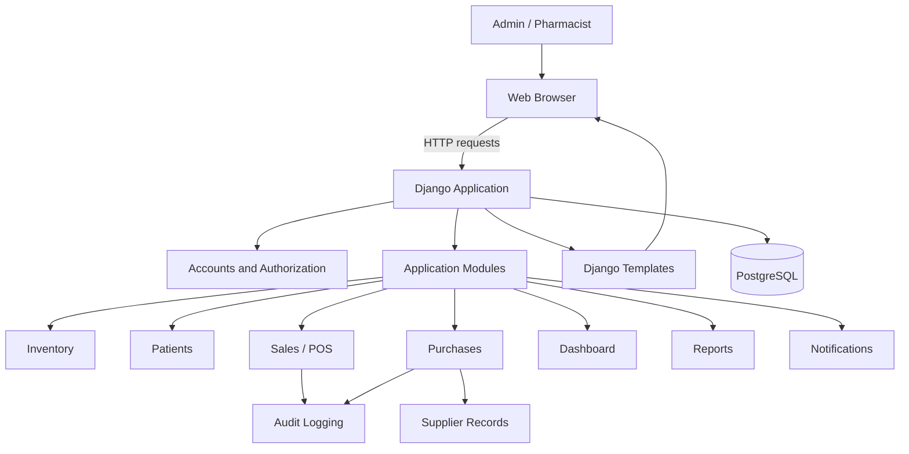
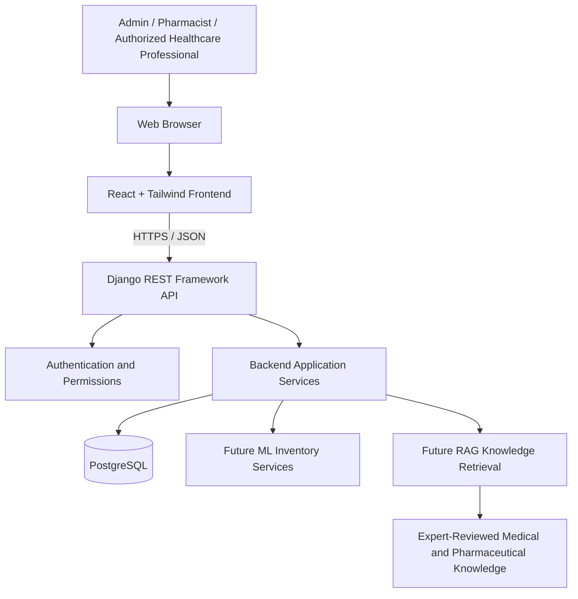

# System Architecture

## 1. Current architecture

The current MVP follows a **Django monolithic architecture**. A single Django application handles URL routing, authentication, authorization, application logic, database operations, and server-rendered HTML pages.

The user interface is built with Django templates, HTML, CSS, and JavaScript. Some workflows also return JSON responses, but the application does not yet have a fully integrated Django REST Framework API.

PostgreSQL is used as the relational database.

### Current architecture diagram

The diagram represents the current operational workflows. Supplier records and audit logging are supporting functionality used by other application workflows rather than independently routed modules.

## 2. Main application modules

The backend contains the following Django applications:

| Application | Responsibility |
|---|---|
| `accounts` | User accounts, authentication, and role information |
| `dashboard` | Role-specific dashboards and operational summaries |
| `inventory` | Drug records, stock information, and inventory operations |
| `suppliers` | Supplier records used in purchasing operations |
| `purchases` | Purchase recording, stock receiving, and purchase-related validation |
| `patients` | Patient registration and patient records |
| `sales` | Point of Sale (POS), sale items, payment methods, and sale status management |
| `reports` | Inventory, sales, patient, purchase, and other operational reports |
| `notifications` | User notifications, including low-stock alerts |
| `audit_logs` | Records selected user and system activities |
| `prescriptions` | Installed application area without a completed user-facing prescription workflow |

All listed applications are registered in Django's `INSTALLED_APPS`. However, only the accounts, patients, inventory, dashboard, sales, purchases, reports, and notifications applications are included as separate feature URL configurations in the main URL configuration.

Supplier records are accessed through purchasing workflows. Audit logging is used by operations in other applications.

The prescriptions application is not part of the current operational workflow and should not be treated as an implemented prescription-management feature.

## 3. Request lifecycle

The current request lifecycle generally follows these steps:

1. A user opens a page or submits a form through the browser.
2. Django's root URL configuration routes the request to the appropriate application URL configuration.
3. Authentication and authorization checks determine whether the user can access the requested operation.
4. The view handles the request, validates input, and coordinates the relevant application logic.
5. Where implemented, business operations are delegated to service functions.
6. Django ORM performs database reads and updates against PostgreSQL.
7. The view returns a rendered Django template or an appropriate response, such as JSON for specific workflows.
8. Relevant operations may generate notifications or audit-log entries.

Important business operations use database transactions to help maintain consistency when multiple related records or inventory values are updated.

## 4. Authentication and authorization

The application currently defines two principal user roles:

- **Admin:** Privileged access to administrative and restricted pharmacy operations.
- **Pharmacist:** Access to day-to-day pharmacy operations, subject to role-based restrictions.

Authentication is handled through Django's authentication system, with role-based checks applied to restricted operations.

Examples of restricted operations include:

- Drug creation, which is restricted to administrators.
- Purchase recording, which is restricted to administrators.
- Cancellation of completed sales, which is restricted to administrators.

Authorization must be enforced on the server side through views, decorators, or other permission checks. Hiding a navigation link in the user interface is not a substitute for server-side authorization.

## 5. Business logic and transaction integrity

Important business operations are centralized in service functions where appropriate. This helps keep critical operations reusable and separates some business rules from request-handling code.

### 5.1 Sales and inventory operations

The sales service provides functions for completing sales, cancelling completed sales, and applying inventory changes when completed sales are updated.

Sale completion:

- Combines duplicate drug entries before calculating required stock.
- Locks affected drug records using `select_for_update()`.
- Validates that all requested quantities are available before deducting stock.
- Deducts inventory within a database transaction.
- Rechecks low-stock conditions after stock deductions.

The completion view coordinates this operation with the sale status update, invoice number generation, and audit logging.

Sale cancellation:

- Is restricted to administrators at the view level.
- Only permits cancellation of completed sales.
- Restores the quantities previously deducted from inventory.
- Updates the sale status to cancelled.
- Records the cancellation in the audit log.

Completed-sale inventory updates also use row locking and validate stock changes before applying them.

### 5.2 Purchase and stock receiving

Purchase creation is handled through a dedicated service function.

The purchase operation:

- Validates the purchase quantity, cost price, date, and idempotency key.
- Uses database transactions to protect related operations.
- Uses an idempotency key to prevent duplicate purchase processing.
- Handles concurrent duplicate submissions through database uniqueness protection.
- Locks the affected drug record before increasing stock.
- Rechecks the drug's low-stock condition after replenishment.
- Records the purchase in the audit log.

Purchase recording is restricted to administrators.

These safeguards help maintain inventory consistency and prevent duplicate stock updates during purchase and sales operations.

Automated tests should continue to cover these behaviours whenever the relevant services, views, or models change.

## 6. Deployment architecture

The intended deployment shape for the current MVP is a Django web service connected to a PostgreSQL database.

Django serves the application pages through its template system. The current frontend does not operate as a separate React application.

Uploaded media requires a durable storage strategy. An ephemeral application filesystem should not be treated as permanent storage for uploaded files.

Production deployment also requires appropriate environment configuration, secure database credentials, reliable backups, monitoring, and suitable access controls.

See the [Deployment Guide](DEPLOYMENT.md) for deployment configuration and procedures.

## 7. Planned architectural evolution

The future direction is to evolve the current single-pharmacy MVP toward a more comprehensive hospital pharmacy management system.

One planned architectural improvement is to separate the frontend from the backend through a React application communicating with Django REST Framework endpoints.

### Proposed future architecture

Planned areas include:

1. **Frontend separation:** Introduce React and Tailwind CSS while retaining existing Django workflows until equivalent frontend functionality is implemented and tested.
2. **API development:** Introduce documented Django REST Framework endpoints for frontend communication and future integrations.
3. **Clinical records:** Extend patient management to support appropriate clinical notes and health records, with strict privacy and access controls.
4. **RAG-supported clinical decision support:** Explore retrieval-augmented generation using expert-reviewed medical and pharmaceutical knowledge to assist healthcare professionals, without replacing professional clinical judgment.
5. **Machine-learning inventory intelligence:** Introduce demand forecasting and replenishment recommendations to help reduce stock-outs, wastage, and overstocking.

This proposed architecture describes the project's future direction, not its current implementation. These components should be introduced incrementally and validated before replacing existing operational workflows.
