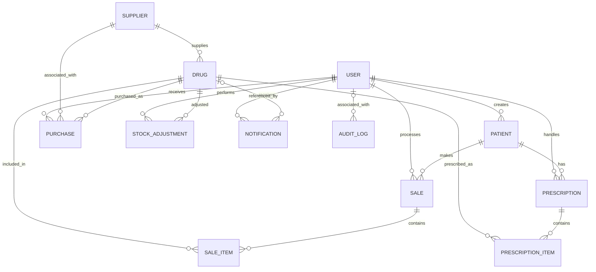

# Entity Relationship Diagram (ERD)

## 1. Overview

The pharmacy management system uses PostgreSQL as its relational database. Its current data model contains **12 application models across 9 Django apps**.

The ERD documents the models currently defined in the project. The `Prescription` and `PrescriptionItem` models exist in the database schema, but their associated workflow is not yet fully implemented.

The `dashboard` and `reports` apps do not currently define independent database models.

## 2. Entity Relationship Diagram



**Relationship notation:** `||` represents exactly one related record, `o|` represents zero or one, and `o{` represents zero or many.

The diagram represents the foreign-key relationships defined by the models. For example, a `Sale` must reference one patient, while a patient can have multiple sales.

## 3. Entity descriptions and fields

### 3.1 User

**App:** `accounts`

The custom `User` model extends Django's `AbstractUser`, inheriting standard authentication fields such as username, password, email, first name, last name, and account-status fields.

| Field | Type | Description |
|---|---|---|
| id | BigAutoField | Primary key |
| role | CharField(20) | ADMIN or PHARMACIST; defaults to PHARMACIST |
| phone_number | CharField(15) | Optional phone number |
| created_at | DateTimeField | Account creation timestamp |
| updated_at | DateTimeField | Last update timestamp |

### 3.2 Supplier

**App:** `suppliers`

| Field | Type | Description |
|---|---|---|
| id | BigAutoField | Primary key |
| company_name | CharField(150) | Unique supplier company name |
| contact_person | CharField(100) | Contact person's name |
| phone | CharField(20) | Supplier phone number |
| email | EmailField | Unique email address |
| address | TextField | Supplier address |
| city | CharField(100) | Supplier city |
| country | CharField(100) | Defaults to Kenya |
| is_active | BooleanField | Whether the supplier is active |
| created_at | DateTimeField | Creation timestamp |
| updated_at | DateTimeField | Last update timestamp |

### 3.3 Drug

**App:** `inventory`

| Field | Type | Description |
|---|---|---|
| id | BigAutoField | Primary key |
| supplier_id | ForeignKey | References Supplier |
| name | CharField(150) | Drug name |
| generic_name | CharField(150) | Generic drug name |
| brand | CharField(100) | Drug brand |
| barcode | CharField(100) | Unique barcode |
| batch_number | CharField(100) | Drug batch number |
| category | CharField(20) | Drug category |
| unit | CharField(20) | Packaging or dispensing unit |
| cost_price | DecimalField(10,2) | Purchase cost per unit |
| selling_price | DecimalField(10,2) | Selling price per unit |
| quantity_in_stock | PositiveIntegerField | Current stock quantity; defaults to 0 |
| minimum_stock | PositiveIntegerField | Low-stock threshold; defaults to 10 |
| expiry_date | DateField | Expiry date |
| description | TextField | Optional description |
| created_at | DateTimeField | Creation timestamp |
| updated_at | DateTimeField | Last update timestamp |

The supplier foreign key uses `PROTECT`, preventing deletion of a supplier that is referenced by a drug.

### 3.4 StockAdjustment

**App:** `inventory`

Records manual changes to a drug's stock quantity.

| Field | Type | Description |
|---|---|---|
| id | BigAutoField | Primary key |
| drug_id | ForeignKey | References Drug |
| quantity_change | IntegerField | Quantity added or removed |
| reason | TextField | Reason for the adjustment |
| adjusted_by_id | ForeignKey | References User |
| created_at | DateTimeField | Adjustment timestamp |

The model's custom save behaviour applies the stock change when a new adjustment is created, prevents the resulting stock from becoming negative, and records an audit entry.

Both foreign keys use `PROTECT`.

### 3.5 Purchase

**App:** `purchases`

Records stock received from suppliers.

| Field | Type | Description |
|---|---|---|
| id | BigAutoField | Primary key |
| drug_id | ForeignKey | References Drug |
| supplier_id | ForeignKey | References Supplier |
| received_by_id | ForeignKey | References User |
| quantity | PositiveIntegerField | Quantity received |
| cost_price | DecimalField(10,2) | Purchase cost per unit |
| purchase_date | DateField | Date of purchase |
| invoice_number | CharField(100) | Optional supplier invoice number |
| purchase_reference | CharField(30) | Unique, nullable purchase reference |
| idempotency_key | UUIDField | Unique, nullable idempotency key |
| remarks | TextField | Optional remarks |
| created_at | DateTimeField | Record creation timestamp |

The three foreign keys use `PROTECT`. The purchase reference and idempotency key are both unique and nullable.

### 3.6 Patient

**App:** `patients`

Stores basic patient registration information.

| Field | Type | Description |
|---|---|---|
| id | BigAutoField | Primary key |
| patient_number | CharField(20) | Unique patient number, generated automatically |
| first_name | CharField(100) | Patient's first name |
| last_name | CharField(100) | Patient's last name |
| gender | CharField(10) | Male, Female, or Other |
| date_of_birth | DateField | Patient's date of birth |
| phone | CharField(20) | Optional phone number |
| email | EmailField | Optional email address |
| address | TextField | Optional address |
| created_by_id | ForeignKey | References User who registered the patient |
| created_at | DateTimeField | Registration timestamp |
| updated_at | DateTimeField | Last update timestamp |

The patient number is generated using the patient's database ID after the initial record is saved. The `created_by` foreign key uses `PROTECT`.

### 3.7 Sale

**App:** `sales`

Stores the main information for a point-of-sale transaction.

| Field | Type | Description |
|---|---|---|
| id | BigAutoField | Primary key |
| patient_id | ForeignKey | References Patient |
| pharmacist_id | ForeignKey | References User who processed the sale |
| sale_date | DateTimeField | Automatically set when created |
| invoice_number | CharField(30) | Unique, nullable invoice number |
| total_amount | DecimalField(10,2) | Total sale amount; defaults to 0.00 |
| payment_method | CharField(10) | Cash, MPesa, or Card |
| status | CharField(20) | Pending, Completed, or Cancelled; defaults to Pending |

Both foreign keys use `PROTECT`. A patient is required for every sale; the patient relationship is not optional.

### 3.8 SaleItem

**App:** `sales`

Stores individual drug items belonging to a sale.

| Field | Type | Description |
|---|---|---|
| id | BigAutoField | Primary key |
| sale_id | ForeignKey | References Sale |
| drug_id | ForeignKey | References Drug |
| quantity | PositiveIntegerField | Quantity sold |
| unit_price | DecimalField(10,2) | Selling price per unit |
| subtotal | DecimalField(10,2) | Quantity multiplied by unit price |

The sale foreign key uses `CASCADE`, while the drug foreign key uses `PROTECT`. The subtotal is calculated by the model's save method.

### 3.9 Notification

**App:** `notifications`

Stores notifications associated with individual users.

| Field | Type | Description |
|---|---|---|
| id | BigAutoField | Primary key |
| title | CharField(150) | Notification title |
| message | TextField | Notification message |
| type | CharField(20) | Notification category |
| is_read | BooleanField | Read status; defaults to False |
| user_id | ForeignKey | References User who receives the notification |
| drug_id | ForeignKey | Optional reference to Drug |
| created_at | DateTimeField | Creation timestamp |

Notification types include LOW_STOCK, EXPIRY, PURCHASE, PRESCRIPTION, SALE, and GENERAL.

The user foreign key uses `CASCADE`. The optional drug foreign key also uses `CASCADE`.

### 3.10 AuditLog

**App:** `audit_logs`

Stores records of selected system activities for accountability and traceability.

| Field | Type | Description |
|---|---|---|
| id | BigAutoField | Primary key |
| user_id | ForeignKey | Optional reference to User |
| action | CharField(20) | CREATE, UPDATE, DELETE, LOGIN, LOGOUT, VIEW, PRINT, or EXPORT |
| table_name | CharField(100) | Name of the affected table |
| record_id | PositiveBigIntegerField | ID of the affected record |
| description | TextField | Description of the activity |
| ip_address | GenericIPAddressField | Optional IP address |
| timestamp | DateTimeField | Automatically recorded timestamp |

The user foreign key uses `SET_NULL`. Therefore, an audit record can remain even if its associated user is deleted.

### 3.11 Prescription

**App:** `prescriptions`

The model is present in the database schema, but the prescription workflow is not yet fully implemented.

| Field | Type | Description |
|---|---|---|
| id | BigAutoField | Primary key |
| patient_id | ForeignKey | References Patient |
| pharmacist_id | ForeignKey | References User |
| prescription_number | CharField(30) | Unique prescription number |
| doctor_name | CharField(150) | Prescribing doctor's name |
| notes | TextField | Optional notes |
| status | CharField(20) | Pending, Dispensed, Cancelled, or Expired |
| created_at | DateTimeField | Creation timestamp |

The patient foreign key uses `CASCADE`; the pharmacist foreign key uses `PROTECT`.

### 3.12 PrescriptionItem

**App:** `prescriptions`

Stores individual drugs and dosage details associated with a prescription.

| Field | Type | Description |
|---|---|---|
| id | BigAutoField | Primary key |
| prescription_id | ForeignKey | References Prescription |
| drug_id | ForeignKey | References Drug |
| quantity | PositiveIntegerField | Prescribed quantity |
| dosage | CharField(100) | Dosage instructions |
| duration | CharField(100) | Prescription duration |

The prescription foreign key uses `CASCADE`, while the drug foreign key uses `PROTECT`.

## 4. Relationship and deletion rules

The database uses Django foreign-key deletion behaviours to maintain referential integrity.

| Relationship | On deletion | Effect |
|---|---|---|
| Supplier → Drug | PROTECT | A supplier referenced by a drug cannot be deleted. |
| Drug → Purchase | PROTECT | A drug referenced by a purchase cannot be deleted. |
| Supplier → Purchase | PROTECT | A supplier referenced by a purchase cannot be deleted. |
| User → Purchase | PROTECT | A user who received purchases cannot be deleted while referenced. |
| Patient → Sale | PROTECT | A patient with associated sales cannot be deleted. |
| User → Sale | PROTECT | A user associated with sales cannot be deleted while referenced. |
| Sale → SaleItem | CASCADE | Deleting a sale deletes its sale items. |
| Drug → SaleItem | PROTECT | A drug referenced by a sale item cannot be deleted. |
| Drug → StockAdjustment | PROTECT | A drug with stock adjustments cannot be deleted. |
| User → StockAdjustment | PROTECT | A user who performed adjustments cannot be deleted while referenced. |
| User → Notification | CASCADE | Deleting a user deletes their notifications. |
| Drug → Notification | CASCADE | Deleting a drug deletes notifications referencing it. |
| User → AuditLog | SET_NULL | The audit record remains, but its user reference is cleared. |
| Patient → Prescription | CASCADE | Deleting a patient deletes associated prescriptions. |
| User → Prescription | PROTECT | A pharmacist referenced by a prescription cannot be deleted. |
| Prescription → PrescriptionItem | CASCADE | Deleting a prescription deletes its items. |
| Drug → PrescriptionItem | PROTECT | A drug referenced by a prescription item cannot be deleted. |

## 5. Important model and database notes

- The `User` model is custom and extends Django's `AbstractUser`.
- A sale requires a patient; the patient foreign key is not nullable.
- A notification may exist without a related drug because its drug foreign key allows `NULL`.
- An audit log may exist without a related user because its user foreign key allows `NULL`.
- A sale can have zero or more `SaleItem` records at the database relationship level. The sale workflow applies additional validation when completing a transaction.
- `Drug.quantity_in_stock` and `Drug.minimum_stock` are non-negative integer fields.
- Monetary values use decimal fields with two decimal places.
- Unique fields and nullable fields are documented according to the model definitions and migration history, not inferred from whether a form field is optional.

## 6. Migration verification

The ERD was checked against the current Django models and migration state.

The following verification commands were run:

```bash
python manage.py showmigrations
python manage.py makemigrations --check --dry-run
python manage.py sqlmigrate inventory 0001
python manage.py sqlmigrate inventory 0003
```

All listed application migrations were applied. Django reported `No changes detected` for the migration check. The inventory migration `0003` was a no-op, so the initial barcode definition remains in effect: a required, unique `varchar(100)` column.

The ERD should be updated whenever model relationships, fields, constraints, or deletion behaviours change.
